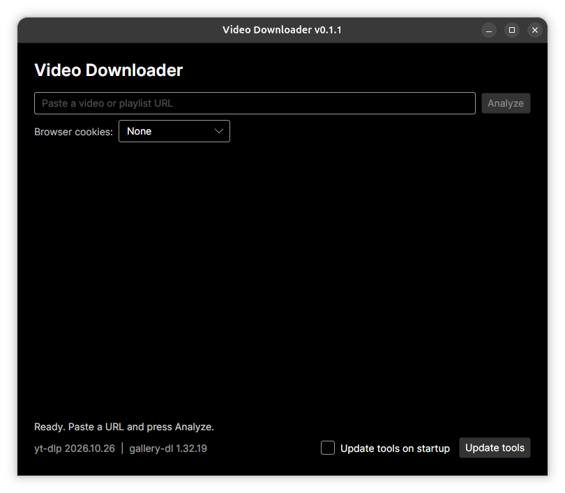
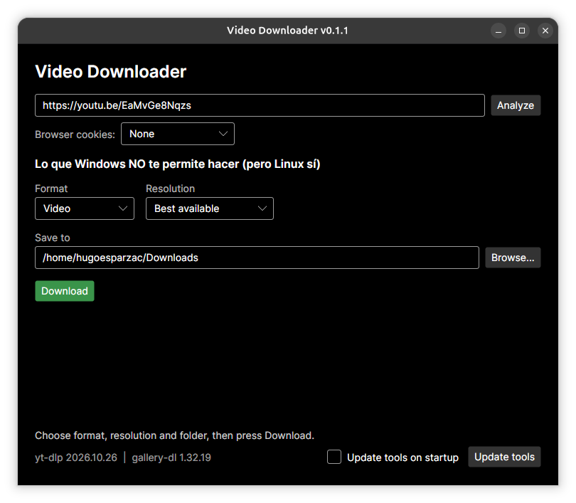

<h1 align="center">Video Downloader</h1>

<div align="center">

[](LICENSE)
[](CONTRIBUTING.md)

---


---

</div>

A cross-platform desktop app for downloading videos, audio and images from YouTube, TikTok, Instagram, X, Facebook and many other sites. Built with C# and Avalonia, it works on Windows, Linux and macOS.





## Features

- Download video (MP4) with a selectable resolution, or audio only (MP3)
- Lists the resolutions available for each video before downloading
- Playlists: saved in a folder named after the playlist, numbered in order, and failed videos are skipped and reported at the end
- Image posts (TikTok photo posts, Instagram carousels) through gallery-dl
- Progress bar and cancellation, with no leftover partial files
- Optional browser cookies for content that requires login
- Built-in "Update tools" button, plus an optional check on startup, because sites change often
- Remembers your folder, format and browser between sessions

## Installation

Download the package for your system from the [Releases](../../releases) page. No .NET installation is needed.

### Windows

Unzip the archive and run `VideoDownloader.exe`. Windows SmartScreen may warn about an unsigned app: choose "More info" and then "Run anyway".

### Linux

```bash
tar -xzf VideoDownloader-<version>-linux-x64.tar.gz
./install.sh
```

This installs the app for your user and adds it to your applications menu. To remove it, run `./uninstall.sh`.

### macOS

Extract the archive and run the `VideoDownloader` binary. Because the app is unsigned, open it with right click > Open the first time. gallery-dl is not downloaded automatically on macOS: install it with `brew install gallery-dl`.

> macOS support has not been tested yet.

## Usage

1. Paste a link and press **Analyze**.
2. Choose video or audio, the resolution and the destination folder.
3. Press **Download**.

On first launch the app downloads yt-dlp and ffmpeg automatically (and gallery-dl on Windows and Linux when needed).

### Browser cookies

Some content (most Instagram posts, some TikTok videos) requires being signed in. Pick a browser under **Browser cookies** after signing in to the site there.

On Windows, Chrome, Edge and Brave protect their cookies from other programs, so use **Firefox** there.

## Building from source

Requirements: the .NET SDK version in `global.json`.

```bash
git clone https://github.com/hugoesparzac/VideoDownloader.git
cd VideoDownloader
dotnet tool restore
dotnet husky install
dotnet build
dotnet test
dotnet run --project src/VideoDownloader.App
```

To build the release packages for all platforms:

```bash
./scripts/publish.sh 0.1.1
```

The packages are written to `artifacts/`.

## Project structure

```
src/
  VideoDownloader.Core/   Download logic (yt-dlp, gallery-dl, settings), no UI
  VideoDownloader.App/    Avalonia UI (MVVM)
tests/
  VideoDownloader.Core.Tests/
scripts/                  Packaging script
packaging/linux/          Linux installer and desktop entry
```

## Development

- Commits follow [Conventional Commits](https://www.conventionalcommits.org/), enforced by a Husky git hook and checked on pull request titles.
- Code style is enforced with `.editorconfig`, analyzers and `dotnet format` (pre-commit hook and CI).
- CI builds and checks formatting on every push and pull request. Pushing a `v*` tag builds the packages and creates a GitHub release.

## Acknowledgments

This app is a graphical front end built on top of these projects:

- [yt-dlp](https://github.com/yt-dlp/yt-dlp)
- [gallery-dl](https://codeberg.org/mikf/gallery-dl)
- [YoutubeDLSharp](https://github.com/Bluegrams/YoutubeDLSharp)
- [Avalonia](https://avaloniaui.net/)
- [FFmpeg](https://ffmpeg.org/)

## Disclaimer

This tool is intended for personal use. Respect the terms of service of each site and the copyright of the content you download.

## License

See [LICENSE](LICENSE).